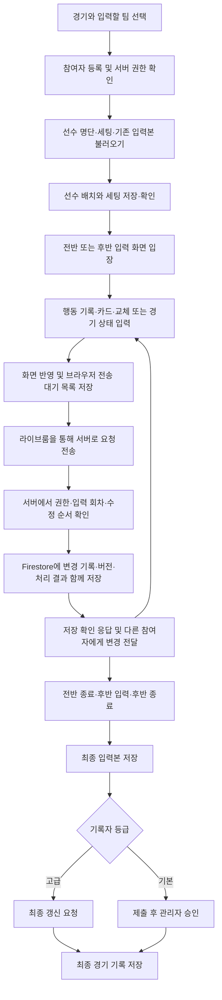

# 경기 데이터 입력 과정

이 문서는 팀원이 경기 입력 기능의 전체 흐름을 이해할 수 있도록 정리한 공유용 안내입니다. 경기 준비, 라이브룸 참여, 기록 입력, Firestore 저장, 최종 확정과 재수정까지 설명합니다. 코드와 대조할 수 있도록 파일명·필드명·저장 경로는 원래 표기를 유지했습니다.

## 1. 먼저 알아둘 핵심

경기를 입력하는 동안에는 팀원들이 **공동 작업 중인 데이터**를 함께 수정합니다. 이 데이터를 임시 입력본(`Draft`)이라고 부릅니다. 라이브룸은 같은 경기의 같은 팀을 입력하는 사람들에게 변경 내용을 전달하고, 저장 상태와 접속 상태를 보여주는 기능입니다.

입력한 내용은 화면에 먼저 반영되고, 브라우저의 전송 대기 목록에 저장된 뒤 서버로 전달됩니다. 서버가 Firestore 저장을 완료했다고 응답해야 해당 요청의 저장이 확정됩니다. 경기 종료 후 최종 갱신을 하면 임시 입력본을 최종 경기 기록(`RAW`)으로 옮깁니다.

**따라서 화면에 보이는 것, 서버에 저장된 것, 최종 경기 기록으로 확정된 것은 서로 다른 단계입니다.**

| 단계 | 의미 | 저장 위치 |
| --- | --- | --- |
| 화면 반영 | 방금 입력한 내용을 즉시 보여줌 | 브라우저 메모리 |
| 전송 대기 | 서버에 보낼 요청을 보관함. 새로고침해도 다시 꺼낼 수 있음 | 브라우저의 IndexedDB |
| 공동 입력 저장 | 서버가 저장을 확인했고, 다른 팀원도 변경 내용을 받을 수 있음 | Firestore의 `inputDrafts` |
| 최종 확정 | 경기 입력을 마무리해 최종 기록으로 반영함 | Firestore의 `matches/{gmId}/recordings/{side}` |

홈팀(`H`)과 원정팀(`A`)은 서로 다른 임시 입력본을 사용합니다. 즉, 라이브룸의 작업 단위는 **경기 한 개 + 입력할 팀 한쪽**입니다.

## 2. 전체 흐름



위 그림은 정상적인 처리 흐름입니다. 연결 끊김이나 동시 수정이 발생했을 때의 처리는 7절에서 설명합니다.

## 3. 경기 준비와 라이브룸 입장

### 3-1. 경기와 참여 역할 확인

경기와 홈·원정 중 입력할 팀을 선택하면 서버가 참여자를 등록합니다. 서버는 로그인한 사용자, 선택한 경기, 참여 역할, 기록자 등급을 확인합니다.

| 역할 | 주요 작업과 권한 |
| --- | --- |
| 주 분석관(`primary`) | 경기 세팅과 시계·전후반 진행 상태를 제어하고, 기록을 입력하며 제출 또는 최종 갱신을 진행 |
| 부 분석관(`assistant`) | 행동 기록 등 입력 작업에 참여. 주 분석관 권한이 필요한 세팅·경기 진행 상태 변경은 제한 |
| 관리자(`manager`) | 권한이 허용된 수정·복원 작업 수행. 주 분석관이 없는 수정 작업에서는 경기 진행 제어를 맡을 수 있음 |

화면의 버튼 표시만으로 권한을 판단하지 않습니다. 실제 저장 요청을 처리할 때 서버가 다시 검사합니다. 요청에 들어 있는 기록자 등급도 서버의 참여자 정보와 일치해야 합니다.

### 3-2. 입력에 필요한 데이터 준비

입장 API는 참여자 등록 후 다음 데이터를 병렬로 불러옵니다.

- 선수 명단: 화면에서 선택하고 배치할 선수 목록
- 세팅: 포메이션, 진영 방향, 선수 배치, 교체 정보, 입력 모드
- 임시 입력본: 이미 저장된 행동 기록, 카드와 경기 진행 상태

세팅은 별도로 가져오므로 임시 입력본 조회에서 같은 세팅을 중복으로 불러오지 않습니다. 입력 화면 코드도 준비 과정에서 미리 불러와 입장 지연을 줄입니다. 로비의 경기 지표(`KPI`)는 경기 진행 단계에 맞춰 미리 조회합니다.

### 3-3. 세팅 저장과 전후반 입장

선수 배치와 세팅을 저장한 뒤에는 **서버가 확인한 세팅**을 기준으로 입장합니다. 세팅을 준비하는 것만으로 경기 시계를 시작하지는 않습니다.

저장 확인은 실제 화면의 선수 배치와 교체 항목을 기준으로 비교합니다. 서버 내부 관리 정보나 객체 속성 순서가 달라졌다는 이유로 세팅이 바뀌었다고 판단하지 않습니다. 다만 저장 중 사용자가 값을 바꿨다가 원래 값으로 돌린 경우에도 수정이 있었다는 사실을 별도로 확인합니다. 입장 직전에는 경기·팀·사용자와 제어 권한도 다시 확인합니다.

입장 준비가 끝나면 저장된 세팅을 이용해 전반 또는 후반 입력 화면으로 바로 이동합니다. 시작 요청은 서버의 저장 확인을 받을 때까지 전송 대기 목록에 남습니다. 화면은 이 요청이 저장 중인지, 거절됐는지를 표시합니다.

## 4. 기록 한 건이 저장되는 과정

예를 들어 분석관이 행동 기록(`ACT`) 한 건을 추가하면 다음 순서로 처리합니다.

1. **화면에 먼저 반영합니다.** 서버 응답을 기다리는 동안에도 입력 작업을 이어갈 수 있습니다.
2. **저장 요청을 만듭니다.** 변경된 기록과 요청 식별자, 기준 버전, 입력 회차를 담습니다.
3. **브라우저에 요청을 먼저 보관합니다.** 전송 대기 목록에 저장한 뒤 서버로 보냅니다.
4. **서버가 요청을 검증합니다.** 참여 권한, 대상 경기·팀, 입력 회차, 같은 기록의 동시 수정 여부를 확인합니다.
5. **Firestore에 함께 저장합니다.** 변경된 기록, 입력본의 새 버전, 해당 요청의 처리 결과를 하나의 트랜잭션으로 저장합니다.
6. **서버가 저장 확인을 보냅니다.** 요청 식별자와 저장된 버전, 변경된 기록을 응답합니다.
7. **화면과 전송 대기 목록을 정리합니다.** 응답이 해당 요청과 일치하면 대기 목록에서 제거하고, 다른 참여자 화면에도 변경 내용을 반영합니다.

여기서 트랜잭션은 여러 저장 작업을 하나의 묶음으로 처리하는 방식입니다. 일반 기록 저장에서는 기록만 저장되고 처리 결과가 빠지거나, 처리 결과만 남고 기록은 빠지는 일을 막습니다.

### 요청에 붙는 세 가지 값

| 코드 이름 | 쉬운 설명 | 필요한 이유 |
| --- | --- | --- |
| `commandId` | 저장 요청마다 붙이는 고유 번호 | 같은 요청을 재전송해도 중복 저장하지 않기 위해 |
| `baseRevision` | 요청을 만들 때 기준으로 삼은 서버 버전 | 입력 기준을 확인하기 위해. 일반 입력에서는 과거 버전이라는 이유로 동시 수정을 중단하지 않음 |
| `roomEpoch` | 현재 입력 작업의 회차 번호 | 종료되거나 바뀐 작업에 예전 요청이 뒤늦게 적용되는 것을 막기 위해 |

일반 입력 요청에는 `edit` 정보를 함께 보관합니다. 보정된 요청 생성 시각(`changedAtMs`), 기기 식별자(`deviceId`), 기기 내 요청 순번(`sequence`), 수정 전 항목 값(`before`)입니다. 기존 입장·조회·저장 응답의 서버 시각(`serverTimeMs`)으로 기기 시각의 차이를 보정하며, 시간 보정을 위해 별도의 전체 기록 조회를 추가하지 않습니다. 이 시각은 경기 발생 시간인 전·후반과 경기 초를 대체하지 않습니다.

같은 기록의 서로 다른 항목은 합칩니다. 같은 항목은 보정된 수정 시각이 늦은 요청을 적용합니다. 시각까지 같으면 같은 기기에서는 요청 순번이 큰 변경을, 서로 다른 기기에서는 서버가 처음 저장 처리한 순번이 큰 변경을 적용합니다. 중간에 다른 기기의 수정이 있어도 이미 확인한 기기 순번보다 낮은 요청은 다시 최신이 되지 않습니다. 수정 시각·기기 순번은 재전송과 새로고침 후에도 유지하고, 같은 요청은 기존 처리 내역을 반환하므로 재전송이 순서를 바꾸지 않습니다.

네트워크 지연과 기기 시계 오차 때문에 현실에서 거의 동시에 일어난 수정의 선후를 완벽하게 알 수는 없습니다. 저장된 수정 정보와 서버 순번을 기준으로 일관되게 처리합니다. 이 정보가 없는 구버전 대기 요청은 원래 내용과 번호를 유지해 재처리하고 서버 처리 시각·순번으로 판단합니다.

서버의 저장 확인 응답을 코드에서는 `ACK`라고 부릅니다. ACK의 `savedRevision`은 해당 요청이 저장된 버전입니다.

일반 행동 기록 수정은 해당 기록만 저장하고 시계·진행 상태는 함께 보내지 않습니다. 다만 골 추가, 골 결과 수정, 골 기록 삭제로 점수가 바뀌는 경우에는 주 분석관의 점수 변경을 해당 기록과 함께 저장합니다. 시계 보정·일시정지·전후반 진행 변경은 별도의 명시적인 상태 저장으로 처리합니다.

한 번 만든 요청의 내용과 번호는 재전송 시에도 유지합니다. 같은 사용자가 같은 번호와 내용으로 다시 보내면 서버는 원래 저장 결과를 반환합니다. 같은 번호를 다른 내용이나 다른 사용자가 재사용하면 거절합니다.

### 실시간 전송과 재전송

평소의 기록·세팅 저장은 실시간 연결(`WebSocket`)을 이용합니다. 저장 확인을 5초 안에 받지 못하거나 전송에 문제가 생기면, 같은 요청 번호와 같은 내용으로 일반 API 요청(`HTTP`)을 시도합니다. HTTP 요청에도 제한 시간을 둡니다.

서버 저장은 성공했지만 ACK만 사라진 경우에도 이 방식으로 결과를 다시 확인할 수 있습니다. 연결이 끊기면 대기 요청을 보관하고, 재연결 후 앞선 요청부터 다시 처리합니다. 늦게 도착한 변경을 최신 값과 합치는 규칙은 7절에 설명합니다.

브라우저 대기 목록의 데이터베이스 이름은 `jpd-did-live-commands`입니다. 로그인 사용자·경기·홈 또는 원정 팀별로 요청을 구분하고, 만들어진 순서대로 보관합니다.

## 5. Firestore에는 무엇을 어디에 저장하나

브라우저는 Firestore에 직접 기록을 쓰지 않습니다. 서버가 검증과 저장을 담당합니다. 별도의 `liveMatches` 컬렉션을 만들지 않고, 기존 `inputDrafts`를 공동 입력의 기준으로 사용합니다.

### 5-1. 입력 중인 데이터

아래 경로에서 `{gmId}`는 경기 ID, `{side}`는 `H` 또는 `A`입니다.

```text
inputDrafts/{gmId}_{side}               ← 공동 입력본의 기본 문서
  records/{recordId}                   ← 행동 기록
  cards/{cardId}                       ← 카드 기록
  substitutions/{substitutionId}       ← 교체 기록
  commands/{commandId}                 ← 요청 처리 결과
  presence/{sessionId}                 ← 연결별 접속 상태
```

| 저장 대상 | 담는 내용과 역할 |
| --- | --- |
| 입력본 기본 문서 | 세팅, 참여자와 주 분석관, 공동 경기 상태, 현재 버전(`revision`), 입력 회차(`roomEpoch`), 종료·확정·복원 처리 상태, 최근 변경(`lastEvent`) 등 |
| `records` | 행동 기록별 데이터와 마지막 수정 버전·수정자 |
| `cards` | 카드 기록별 데이터와 마지막 수정 버전·수정자 |
| `substitutions` | 교체 기록별 데이터와 마지막 수정 버전·수정자 |
| `commands` | 중복 처리를 막고 재전송 결과를 확인하기 위한 요청별 처리 내역 |
| `presence` | 소켓 연결별 사용자, 접속 여부, 마지막 확인 시각과 만료 시각 |

행동·카드·교체 기록의 최신 내용은 각각의 하위 컬렉션을 기준으로 합칩니다. 입력본 기본 문서의 과거 기록 목록으로 다른 사람의 최신 기록을 덮어쓰지 않습니다. 브라우저의 화면 복구용 정보에도 기록 배열을 넣지 않습니다. 전체 기록이 필요한 경우 서버가 하위 컬렉션을 읽어 입력본을 구성합니다.

### 5-2. 서버의 일반 저장 순서

1. 입력본 기본 문서, 요청의 기존 처리 결과, 이번에 변경할 기록을 읽습니다.
2. 이미 처리한 요청이면 기존 결과를 반환합니다.
3. 새 요청이면 권한과 회차를 검사하고 항목별 수정 순서를 비교합니다.
4. 변경된 기록과 필요한 세팅·경기 상태를 반영합니다.
5. 입력본 버전을 올리고, 수정된 기록에도 해당 버전과 수정자를 남깁니다.
6. 요청 처리 결과와 최근 변경 내용을 같은 트랜잭션으로 저장합니다.
7. 저장이 끝난 뒤 ACK와 다른 참여자에게 보낼 변경 내용을 만듭니다.

일반 저장 요청마다 전체 경기 기록을 다시 조회하지 않습니다. ACK도 전체 이력 대신 변경된 항목과 저장 버전을 전달합니다. 전체 입력본은 처음 준비하거나 서버와 다시 맞춰야 할 때 조회합니다.

### 5-3. 요청이 많이 쌓였을 때

전송 대기 중인 기록·세팅 요청은 최대 20개씩 묶어 처리합니다. 저장 문서 수와 요청 크기에도 제한을 두므로, 요청이 크면 20개보다 적게 묶을 수 있습니다.

서버는 입력본 기본 문서, 요청 처리 결과, 영향을 받는 기록을 일괄 조회하고 순서대로 검증합니다. 받아들인 변경과 처리 결과는 하나의 트랜잭션으로 저장하되, 각 요청은 고유 번호·기준 버전·처리 결과·ACK를 따로 유지합니다.

같은 묶음 안에서 같은 기록을 연속 수정한 경우에는 앞서 승인된 변경을 이어서 처리할 수 있습니다. 그 과정에서 다른 참여자가 수정한 내용을 무시하고 기준 버전을 임의로 바꾸지는 않습니다. 최종 확정과 RAW 복원은 일반 기록 묶음에 섞지 않고 별도로 처리합니다.

## 6. 다른 팀원 화면에는 어떻게 반영되나

서버는 각 소켓 연결에서 Firestore 입력본 기본 문서의 변경을 감시합니다. 기본 문서의 `lastEvent`에 최근 변경 또는 묶음 변경이 저장되므로, 서버 프로세스가 여러 개여도 이를 읽어 각 참여자에게 전달할 수 있습니다. 이때 기록 하위 컬렉션 전체를 다시 읽을 필요는 없습니다.

화면은 받은 변경 내용을 현재 입력에 합칩니다. 중간 버전이 빠졌거나 입력 회차가 바뀌었다면 전체 서버 입력본을 다시 받아 맞춥니다. 소켓을 사용할 수 없을 때는 2초 간격 조회가 보조 수단으로 동작합니다.

**참여자로 등록돼 있는 것과 지금 접속해 있는 것은 별개입니다.** 참여자 등록은 유지되지만 접속 상태는 연결마다 관리합니다. 각 연결의 접속 확인은 30초 동안 유효하고, 주기적인 연결 확인 신호로 연장합니다. 정상 연결 종료 시에는 접속을 닫고, 탭이나 네트워크가 갑자기 사라지면 만료 시간으로 판단합니다.

입력을 하지 않아도 클라이언트는 5초마다 연결 확인 신호를 보냅니다. 정상적으로 타이머가 실행되는 동안 서버 메시지를 30초 넘게 받지 못하면 연결을 닫고 자동 재연결합니다. 백그라운드·절전 때문에 타이머가 오래 멈췄다면, 돌아왔을 때 먼저 확인 신호를 보내고 응답할 시간을 줍니다. 입력 재개만 기다려 재연결하는 구조는 아닙니다. 최초 연결·인증에는 최대 12초를 허용하며, 실패한 연결은 닫고 다시 시도합니다.

일정 화면의 점수·진행 상태 요약은 실시간 저장 ACK와 별도로 갱신합니다. 반복된 갱신 요청은 합쳐 처리하고, 처리 시점의 최신 입력본을 기준으로 요약을 만듭니다. 따라서 일정 요약 조회 때문에 기록 저장 확인이 지연되지 않습니다.

## 7. 연결 끊김·새로고침·동시 수정 처리

### 상황별 동작

| 상황 | 시스템 동작과 팀원이 알아둘 점 |
| --- | --- |
| 두 사람이 서로 다른 기록을 수정 | 서로의 변경을 합쳐 저장할 수 있음 |
| 두 사람이 같은 기록을 수정 | 다른 항목은 합치고, 같은 항목은 수정 순서에 따라 최신 값을 적용. 일반 동시 수정 때문에 입력을 멈추지 않음 |
| 서버 저장 후 ACK가 유실 | 같은 요청을 다시 보내 기존 저장 결과를 확인 |
| 인터넷 연결 끊김 | 미확인 요청을 브라우저에 보관하고, 재연결 후 다시 전송 |
| 저장 확인 전 새로고침 | 브라우저 대기 목록을 읽어 미확인 입력을 화면에 다시 반영 |
| 예전 요청의 ACK가 늦게 도착 | 그 요청에 대한 확인만 처리. 더 최근 수정의 저장 대기 표시를 없애지 않음 |
| 오래된 서버 화면 정보가 도착 | 아직 저장 확인을 받지 못한 로컬 행동·카드·교체 입력을 지우지 않음 |
| 서버 전체 조회가 일시적으로 실패 | 현재 보이는 입력을 유지하고 제한된 간격으로 재시도 |
| 최종 확정 후 예전 오프라인 요청 도착 | 닫힌 입력본과 입력 회차를 검사해 거절 |

예를 들어 같은 기록을 `A → B → A`로 수정했다면, 마지막 값이 처음과 같아도 각각 다른 요청입니다. 첫 번째 요청의 ACK가 마지막 수정까지 저장했다고 판단하지 않도록 요청 번호로 구분합니다.

복구할 때는 서버에서 확인할 수 있는 상태를 기준으로 삼고, 아직 미확인인 요청을 그 위에 다시 반영합니다. 서버는 보정된 수정 시각·기기 순번·서버 최초 처리 순번을 비교합니다. 늦게 도착한 오래된 변경은 최신 값을 덮어쓰지 않으며, 해당 요청에도 최신 항목 값을 포함한 ACK를 보내 대기 목록이 계속 처리되도록 합니다. 오래된 삭제가 최신 기록을 없애거나, 오래된 수정이 최신 삭제를 되돌리는 것도 막습니다.

### 동시 수정과 다른 거절을 처리할 때

공통 저장 상태 표시에서 저장 중·저장 완료·연결 끊김·충돌·거절 상태를 확인할 수 있습니다.

일반적인 같은 기록의 동시 수정은 더 이상 `draft_conflict`로 중단하지 않습니다. 이전 버전에서 이 사유로 대기 목록에 막혀 있던 기록·세팅 요청도 원래 번호와 내용을 유지해 다시 처리합니다. 권한 위반, 닫힌 경기, 바뀐 입력 회차, 서버보다 앞선 잘못된 기준 버전은 기존 검증에 따라 거절합니다. 최종 확정·복원에는 기존의 버전 확인을 유지합니다.

권한이나 입력 회차 등 다른 문제로 거절된 요청은 별도 확인이 필요합니다. 명시적으로 서버 상태에 다시 맞추는 기존 동작은 문제가 된 맨 앞 요청만 취소하고, 서버 입력본을 받아 나머지 요청을 다시 적용·검증합니다. 일반 동시 수정의 순서 판정은 이 수동 동작을 요구하지 않습니다.

부 분석관은 행동 기록을 저장할 때 행동 변경만 보내며, 변경할 기록 없이 시계·진행 상태만 저장하는 요청은 보내지 않습니다. 구버전 클라이언트가 만든 요청 중 **기록을 담지 않은 상태 요청**이 `primary_required`로 명시적으로 거절되면, 안내를 표시하고 그 요청을 취소해 뒤의 행동 기록이 처리되도록 합니다. 다른 거절은 기존의 명시적 해결 절차를 유지합니다. 수정 시각이 최신이어도 주·부 권한을 넘을 수 없습니다.

### 전체 서버 입력본 조회의 안정성

전체 입력본은 읽기 전용 트랜잭션으로 조회해 기록과 세팅이 일관된 상태로 반환되도록 합니다. 읽는 도중 트랜잭션 중단, 제한 시간 초과, 서비스 일시 장애가 발생하면 새로운 트랜잭션과 읽기 캐시로 전체 조회를 다시 시작합니다. 총 3번 시도 후에도 실패하면 `draft_snapshot_busy`와 HTTP 503을 반환합니다.

권한 오류나 실제로 없는 문서는 같은 방식으로 재시도하지 않습니다. 동일 사용자·경기·팀의 중복 복구 조회는 하나로 합칩니다. 소켓이 연결돼 있더라도 전체 복구에 실패하면 화면 입력을 유지하고, 재시도 간격을 조절해 다시 조회합니다.

교체는 두 입력 화면 모두에서 나갈 선수가 필드에 있고 들어올 선수가 벤치에 있을 때만 다시 적용합니다. 이미 반영된 교체가 세팅 ACK를 받았다는 이유로 반대로 적용되는 일을 막기 위한 규칙입니다.

## 8. 전후반 종료와 최종 경기 기록 저장

### 8-1. 전반 종료와 후반 진행

전반 종료는 임시 입력본의 진행 상태를 저장하는 단계입니다. 전반 종료 API도 이 시점에 최종 RAW 기록을 일부 생성하지 않습니다. 후반에는 같은 경기·팀의 입력본을 이어 사용합니다.

기본 흐름은 준비(`ready`) → 전반(`H1`) → 전반 종료(`H1_done`) → 후반(`H2`) → 후반 종료(`H2_done`) → 제출 또는 최종 상태(`final`)입니다. 입력본의 진행 상태가 `final`이 됐다는 것만으로 RAW 저장이 끝난 것은 아닙니다. 기본 등급의 제출·승인 단계와 고급 등급의 최종 갱신 단계가 따로 있습니다.

### 8-2. 등급에 따른 마무리

| 기록자 등급 | 경기 입력 마무리 과정 |
| --- | --- |
| 고급(`advanced`) | 최종 입력본 저장을 확인한 뒤 최종 갱신 요청으로 RAW에 반영 |
| 기본(`basic`) | 최종 입력본을 제출하고 관리자 승인을 기다림. 승인 처리에서 RAW에 반영 |

고급 등급의 라이브룸 최종 갱신과 기본 등급의 관리자 승인 경로는 구분됩니다. 아래의 요청 번호·작업 잠금·닫힌 입력본 유지 설명은 **고급 등급 라이브룸 최종 갱신 경로**를 기준으로 합니다. 현재 기본 등급 승인 API는 별도 승격 경로를 사용하며, 완료 후 입력본을 삭제하도록 호출합니다.

### 8-3. 고급 등급 최종 갱신 순서

1. 최종 갱신 요청을 브라우저 전송 대기 목록에 저장합니다. 일반 입력 요청과 분리해 처리합니다.
2. 서버는 권한, 현재 버전과 입력 회차를 확인하고, 작업 담당권과 유효 기간을 저장합니다. 여러 서버가 같은 작업을 동시에 실행하지 않도록 합니다.
3. 입력본을 확정 처리 중 상태로 바꿔 추가 입력 저장을 막습니다.
4. 서버 입력본 전체를 읽고, 최종 기록 형식과 선택한 경기 정보가 맞는지 검증합니다.
5. 기존 최종 기록을 교체하고 전·후반 행동 기록과 카드 등을 RAW 경로에 저장합니다.
6. 경기 점수, 완료된 경기의 로비 표시 정보, 일정 요약을 갱신합니다.
7. 성공하면 입력본을 닫고 `roomEpoch`를 올린 뒤, 요청 처리 결과를 남겨 ACK를 보냅니다.

최종 경기 기록의 주요 경로는 다음과 같습니다.

```text
matches/{gmId}                         ← 경기 정보와 점수
  recordings/{side}                    ← 팀별 최종 기록 기본 정보
    records/{recordId}                 ← 최종 행동 기록
    cards/{cardId}                     ← 최종 카드 기록
```

선수 배치와 교체 관련 정보는 최종 기록의 라인업 정보에 반영됩니다. 입력 중의 `substitutions` 컬렉션을 RAW에 같은 구조로 그대로 복사하는 방식은 아닙니다. 최종 기록에는 분석 참여자 명단도 반영합니다.

RAW를 교체할 때는 기존 `records`, `cards`, `paths`, `playerStats` 하위 데이터를 정리하고 기본 정보·행동 기록·카드를 다시 씁니다. 경로 분석과 선수 지표는 별도의 계산·저장 대상이므로, 최종 갱신이 기존 계산 결과를 그대로 보존한다고 이해하면 안 됩니다.

### 8-4. 최종 갱신 중 실패한 경우

RAW 교체는 큰 데이터를 여러 묶음으로 나눠 처리합니다. 기존 하위 데이터 삭제와 새 기록 쓰기는 최대 200건 단위로 진행합니다. **전체 RAW 교체가 하나의 트랜잭션으로 한 번에 완료되는 구조는 아닙니다.**

실패하면 같은 요청 번호로 다시 실행해 이어서 완료할 수 있도록 처리합니다. 완료된 요청을 재전송하면 저장된 결과를 돌려줍니다. 성공하기 전까지 입력본은 쓰기가 막힌 상태를 유지합니다.

완료 후에도 고급 등급 라이브룸 경로는 입력본 기본 문서를 닫힌 상태로 남깁니다. 이 상태와 올라간 입력 회차를 함께 확인해, 예전 기기에 남아 있던 오프라인 요청이 경기 입력을 다시 열지 못하도록 합니다.

요청 처리 내역(`commands`)에는 자동 만료를 설정하지 않습니다. 재전송 중복 확인을 위한 기록을 유지하는 정책입니다.

## 9. 확정한 경기 데이터를 다시 수정할 때

확정된 RAW를 조회하는 것만으로 수정용 입력본을 만들지는 않습니다. 권한이 있는 사용자가 명시적으로 복원을 요청하면 RAW를 다시 수정 가능한 임시 입력본으로 구성합니다.

복원도 고유 요청 번호를 가진 전송 대기 요청입니다. 서버는 복원 작업 담당권을 확보하고 입력본 쓰기를 막은 뒤, 이전 행동·카드·교체 하위 데이터를 정리하고 RAW의 기록과 세팅을 복원합니다. 실패 시 같은 번호로 재시도하고, 완료된 요청은 중복 처리하지 않습니다.

복원된 데이터를 수정한 뒤 다시 최종 갱신하면 수정본을 RAW에 반영합니다. 즉, **확정 기록 조회 → 명시적 복원 → 임시 입력본 수정 → 재확정** 순서입니다.

## 10. 개발자가 확인할 주요 파일과 검증 범위

| 파일 | 담당 내용 |
| --- | --- |
| `app/pages/TeamSelection.vue` | 경기 준비, 세팅 확인, 전후반 입장, 제출·최종 갱신 |
| `app/pages/DidInput.vue` | 경기 기록 입력과 변경 저장 요청 |
| `app/composables/useMatchDraft.ts` | 입력본 구성·복구, 세팅 저장, 최종 갱신·RAW 복원 요청 |
| `app/composables/useMatchCollaboration.ts` | 라이브 연결, 다른 참여자의 변경 반영, 미확인 로컬 입력 보호 |
| `app/composables/useLiveRoom.ts` | 전송 순서, 묶음 전송, ACK 처리, 재시도와 충돌 해결 |
| `app/utils/liveOutbox.ts` | 브라우저 IndexedDB 전송 대기 목록 |
| `app/components/LiveRoomStatus.vue` | 공통 연결·저장 상태 표시 |
| `backend/api/api_match_input.py` | 입장·저장 API와 소켓 처리, RAW 변환·승격 |
| `backend/system/system_live_room.py` | 트랜잭션 저장, 요청 중복 확인, 항목별 수정 순서 판정, 접속 상태, 최종 갱신·복원 작업 제어 |
| `backend/system/system_firestore.py` | Firestore 경로별 읽기·쓰기, 입력본 조합, RAW 교체와 화면 요약 저장 |

관련 검증 항목은 다음과 같습니다. 이 목록은 테스트 범위를 안내하며, 이 문서 수정 과정에서 실행한 결과를 뜻하지 않습니다.

- `node --test app/check/liveRoom.test.cjs`: 실제 화면 연동 로직과 제어 가능한 전송·IndexedDB 테스트 환경으로 ACK 유실, 순서 보장, 새로고침 복구, 충돌, 미확인 입력 보호, 늦은 ACK와 새 수정의 경합을 확인합니다.
- 온라인 소켓 저장, 같은 번호의 HTTP 재전송, 로컬 입력 대기 중 다른 참여자 변경 반영을 확인합니다. Firestore SDK 참조·트랜잭션 테스트에서는 기록이 1건 또는 1,000건 있어도 단일 행동 저장에 컬렉션 전체 조회 없이 문서 3개만 읽는지 확인합니다. 작은 행동 요청 50개를 처리할 때 일괄 읽기 호출과 커밋이 각각 3번인지도 확인합니다.
- `backend/check/check_live_room.py`: 요청 처리 결과의 트랜잭션 저장, 커밋 실패, 기록 충돌·병합·삭제, 권한, 접속 만료, 입력 회차, 최종 갱신·복원의 재시도를 확인합니다.
- 기존 API·데이터 형식·경기 지표 테스트와 `pnpm exec nuxt generate`로 관련 기능과 빌드를 확인합니다.

자동 테스트 외에 실제 배포된 Firebase·백엔드 환경에서 브라우저 두 개를 사용해 같은 경기·팀에 참여하고, 입력·동시 수정·연결 끊김·재연결·최종 갱신을 확인해야 합니다.

## 초기 화면의 조회 순서

달력은 `/match-input/calendar`에서 해당 월의 날짜·리그 정보만 받아 경기 날짜를 표시합니다. 기본 선택은 해당 월의 가장 최근 경기 날짜이며, 경기 카드의 상세 내용은 `/match-input/matches?year=…&month=…&date=YYYY-MM-DD`로 선택한 하루만 조회합니다. 이전 날짜나 월의 응답이 늦게 도착해도 현재 선택을 덮지 않습니다.

대기실은 다음 순서를 유지합니다. 한 단계의 표시를 다음 단계의 완료까지 미루면 안 됩니다.

1. `bootstrap?phase=setup`: 선수 명단, 저장된 포메이션·라인업·오더에 따른 배치·진영과 경기 상태를 먼저 표시합니다. 진행 중 경기에서도 ACT·카드 전체 조회나 KPI 계산을 기다리지 않습니다. 저장된 세팅과 교체 정보는 같은 읽기 전용 트랜잭션으로 읽습니다.
2. `bootstrap?phase=preview&half=H1|H2`: 전반 상태에서는 전반, 후반 상태에서는 후반 프리뷰만 먼저 표시합니다. 다른 반기와 전체 KPI를 함께 기다리지 않습니다.
3. 전체 KPI와 라이브룸의 기록 복원을 진행합니다. 기록 복원이 끝나기 전에는 기존 경기 기록을 제출하는 작업을 진행하지 않습니다.

KPI 응답은 수치만 갱신하며 포메이션·라인업·진영을 변경하지 않습니다. 세팅 변경은 명시적인 세팅 저장과 해당 실시간 변경 응답으로 반영합니다. 이 순서는 `app/check/loadingStages.test.cjs`와 백엔드 API·라이브룸 테스트로 검증합니다.
